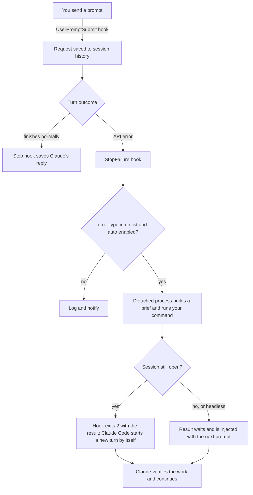

# claude-code-failover

[](https://github.com/erencivril/claude-code-failover/actions/workflows/test.yml)
[](LICENSE)

**Don't let a dead turn kill your Claude Code session.**

When a turn ends in an API error, a safeguard flag or a rate limit, Claude Code stops and waits for you. This plugin catches that moment, hands the task to any other coding agent you choose (Codex, Gemini, Aider, opencode, another Claude model, your own script), and then wakes the session with what that agent did, so Claude carries on without you typing anything.

```
you ▸ refactor the parser module
      API Error: 400 ... appears to violate our Usage Policy        ← turn dies

      [failover] handing the task to your fallback agent…            ← automatic
      [failover] handoff finished (exit 0)                           ← automatic

      The fallback agent refactored parser/ (3 files changed). I've checked
      its work and I'm moving on to the tests…                       ← session wakes itself
```

## Why

Long agent sessions die for reasons that have nothing to do with your task:

- a safety classifier flags a harmless request (security research, reverse engineering and biology tooling are the usual victims),
- the model is overloaded or the API returns a server error,
- you hit a rate or usage limit halfway through a refactor,
- the model declines one small piece and abandons everything else with it.

In each case the work stops until you notice, switch tools, re-explain the task somewhere else, and then explain to Claude what happened. This plugin automates that whole loop.

## What it does

| When this happens | The plugin |
| --- | --- |
| A turn ends in an API error (policy flag, rate limit, overload, server error) | Logs it, notifies you, and, if you enabled `auto`, passes your request and the recent conversation to your fallback agent in the same working directory |
| The fallback agent finishes | Wakes the session by itself with a summary of what the agent did (exit code, files changed, the end of its output), and Claude continues from there |
| The woken turn fails as well | Stops and notifies you instead of handing off again, so it can never loop |
| Claude Code switches models by itself after a flag | Tells Claude to keep going with the task and to list anything it had to leave out |
| Claude declines one piece of a task and stops | Asks Claude once to continue with the rest and list what it skipped, so you can decide what to do with that piece |
| You type `/failover:handoff <task>` | Hands that task to the fallback agent on demand and reports back |
| Claude Code or the plugin is updated | Re-checks itself once in the background and warns you if the update broke it |

Nothing is sent anywhere until you configure a command. With no config the plugin only logs and notifies.

## Install

Requires a recent Claude Code (developed against v2.1.296), [jq](https://jqlang.github.io/jq/) and bash. `python3` is optional and only used by the self-test. macOS and Linux.

```
/plugin marketplace add erencivril/claude-code-failover
/plugin install failover@claude-code-failover
```

Then run the guided setup inside Claude Code:

```
/failover:setup
```

or write the config yourself.

## Configure

`~/.claude/failover.json`:

```json
{
  "command": "codex exec --sandbox workspace-write -",
  "auto": true,
  "on": ["policy", "rate_limit", "overloaded", "server_error"]
}
```

| Key | Default | Meaning |
| --- | --- | --- |
| `command` | none | Shell command that runs the fallback agent. It receives the task brief on stdin and runs in the session's working directory |
| `auto` | `false` | Start the handoff by itself when a turn dies. When `false` you get a notification and run `/failover:handoff` yourself |
| `wake` | `true` | Resume the session by itself when an automatic handoff finishes. When `false` the result waits for your next message |
| `on` | `policy`, `rate_limit`, `overloaded`, `server_error` | Which stops trigger it. `policy` is detected from the error text; the rest are Claude Code's [StopFailure error types](https://code.claude.com/docs/en/hooks) (`unknown`, `invalid_request`, `max_output_tokens`, `model_not_found`, ...) |
| `history` | `6` | How many recent messages (your requests and Claude's final replies) go into the brief |
| `timeout` | `1800` | Seconds before a hung fallback agent is stopped |
| `nudge` | `true` | Ask Claude to continue with the rest when it declines part of a task |
| `notify` | `true` | Desktop notifications (macOS `osascript`, Linux `notify-send`) |
| `selftest` | `true` | Re-check the plugin after Claude Code or the plugin changes version, and warn if it broke |
| `retention_days` | `30` | Session histories and run logs older than this are deleted. `0` keeps them |

### Fallback agent commands

The command must run without prompting and be allowed to edit files. Besides stdin, it gets `FAILOVER_BRIEF_FILE` (path to the brief), `FAILOVER_REASON` and `FAILOVER_SESSION_ID`.

| Agent | Command | Status |
| --- | --- | --- |
| [Codex CLI](https://github.com/openai/codex) | `codex exec --sandbox workspace-write -` | tested |
| Claude Code on another model | `claude -p --model sonnet --permission-mode acceptEdits` | flags checked, recursion-safe |
| Gemini CLI | `gemini --yolo -p "$(cat)"` | untested, check `--help` |
| Aider | `aider --yes-always --message-file "$FAILOVER_BRIEF_FILE"` | untested, check `--help` |
| opencode | `opencode run "$(cat)"` | untested, check `--help` |
| Anything else | `~/bin/my-agent.sh` | your script, your rules |

Working commands for other agents are welcome as pull requests.

## How it works



Details worth knowing:

- **The brief** is your last request plus the last few messages of the conversation, with a short instruction to check the current state of the directory first. It is saved in `~/.claude/failover/runs/<timestamp>/brief.md` next to the agent's full stdout and stderr.
- **Changed files** are found by hashing every dirty file before and after the run, so a file that was already modified still shows up if the fallback agent touches it again.
- **The wake-up** uses Claude Code's `asyncRewake` hook option: the StopFailure hook keeps running in the background while the handoff runs, then exits with code 2 and the result on stderr, and Claude Code starts a new turn with that text as a system reminder.
- **No loops.** If the turn after a wake-up dies too, the plugin logs it, notifies you and does nothing else until you send a message yourself. Separately, the fallback command runs with `FAILOVER_ACTIVE=1` and every hook exits immediately when it sees that, so using `claude -p` as your fallback cannot trigger a second handoff.
- **Headless runs** (`claude -p`) exit within milliseconds of an API error and kill their hooks, so the handoff itself runs in a detached process that survives. To pick up the result in a script, run `claude -p -c "continue"` afterwards.
- **Everything is logged** to `~/.claude/failover/events.jsonl`, one JSON object per line.

## It tells you when an update breaks it

A plugin like this depends on hook events and fields that can change between Claude Code releases, and when a hook stops firing nothing visibly fails: the safety net is just gone. So the plugin checks itself, without polling:

- When a session starts, it compares the Claude Code and plugin versions with the last ones it verified. Nothing changed: it does nothing (about 20 ms, in the background).
- A version changed: it runs one self-test in the background. That is a single headless Claude Code session pointed at a mock API on localhost that rejects the request, with a stub in place of your fallback agent. It verifies that the plugin loads, your prompt is captured, the StopFailure hook fires, the error text is readable and the detached handoff starts. It takes a few seconds, uses no tokens and sends nothing off your machine.
- The test failed: you get a desktop notification, and a one-line warning at the start of your sessions (once a day) until an update fixes it.

Run it on demand with `/failover:selftest`. It needs `python3` for the mock API and is skipped quietly without it. One thing it cannot check is the automatic wake-up of an interactive session, which only happens with a terminal attached.

## Turn on the built-in recovery first

Claude Code already recovers from some stops without leaving the session. These are settings in `~/.claude/settings.json`, and `/failover:setup` offers to add them:

```json
{
  "switchModelsOnFlag": true,
  "fallbackModel": ["sonnet"],
  "autoContinueAtUsageLimit": true
}
```

- `switchModelsOnFlag` re-runs a flagged request on the fallback Claude model instead of pausing to ask you.
- `fallbackModel` serves the turn from another model when the primary one is overloaded or unavailable.
- `autoContinueAtUsageLimit` waits for a usage limit to reset and then continues.

This plugin covers what is left: the stops those settings cannot recover from, and the cases where you would rather have a different agent take the work than wait.

## Limits

- **After a policy stop the conversation itself may stay blocked**, because the check looks at the whole conversation, flagged request included. The plugin wakes the session once; if that turn is stopped again, it leaves the session alone and tells you. Rewind past the flagged request (press Esc twice, or `/rewind`) and send a message: the handoff result is still on disk in the run directory.
- **Automatic resume needs the session to stay open.** If you close it while the fallback agent is working, or the run is headless, the result is delivered with the next prompt in that session instead.
- **The fallback agent gets a summary, not the full transcript**: your last request plus the last few messages.
- **Which error type a real policy block reports is not documented.** The plugin recognises it from the error text. If your stops are logged under another type, add that type to `on`; `events.jsonl` shows what was reported.
- **The refusal nudge is a pattern match** on short replies. It can occasionally fire on a message that was not a refusal, in which case Claude is told to ignore it. Set `"nudge": false` to turn it off.
- Windows is untested.

## Security notes

- **What is stored.** To brief the fallback agent, the plugin keeps the last 40 messages of each session (your prompts and Claude's final replies, truncated), plus each run's brief and agent output, under `~/.claude/failover/`. Files are created owner-only (`umask 077`) and pruned after `retention_days`. `events.jsonl` holds the first 300 characters of each error message.
- **Content crosses between agents.** The brief contains conversation text, and the fallback agent's output is shown to Claude. Both are labelled as records rather than instructions, but a labelled record is still text a model reads: if the session handled untrusted content (a web page, a third-party file), some of it can reach the fallback agent. Give that agent no more permissions than the task needs, for example a workspace-only sandbox.
- **The command runs unattended** with your user's permissions, which is why it is read only from your home directory and never from a project.
- `FAILOVER_TRACE` writes a full shell trace, prompts included. Use it for debugging only and delete the file afterwards.

## FAQ

**Does this bypass Claude's safeguards?**
No. Nothing here changes what any model will do, and a flagged request is never re-sent to the model that flagged it. Your own request goes to the agent you configured, which applies its own rules under your account and its terms. If Claude declines something in its own words, the plugin does not override that either: it only asks Claude to finish the rest of the task and tell you what it left out.

**What leaves my machine?**
With no `command` configured, nothing. With one, the brief (your last request and the recent conversation, up to `history` messages) goes to that command, and from there to whichever provider that agent uses. In `auto` mode this happens without asking each time, on that agent's account and cost.

**Why is the config only read from my home directory?**
Because it names a command that runs unattended. A project-level file would let any repository you clone choose that command.

**Can two agents edit the same directory at once?**
While an automatic handoff is running, any prompt you send tells Claude that it is in progress and to stay off the same files until the result arrives.

## Tests

```
bash tests/test.sh
```

The suite drives the hook and handoff scripts with synthetic hook payloads and a stub agent, on macOS and Linux in CI.

The full path was also verified in real Claude Code sessions (v2.1.296, interactive and headless) against a local mock API that returns a policy-style error: the session stopped, the stub agent ran, and the interactive session resumed by itself with the result. With the mock failing permanently, the plugin handed off once and then stopped.

## Uninstall

```
/plugin uninstall failover@claude-code-failover
rm -rf ~/.claude/failover ~/.claude/failover.json
```

## License

[MIT](LICENSE)
